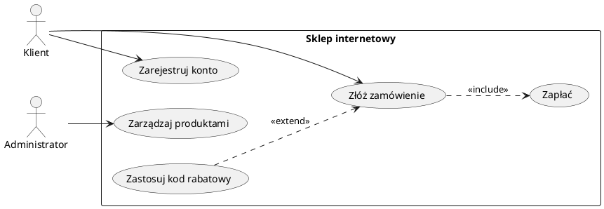

# Spotkanie 2. Wymagania i diagram przypadków użycia

| Czas | Zakres | Wynik pracy |
|---|---|---|
| ok. 85 min | Wymagania, diagram przypadków użycia, scenariusze | Tabela wymagań, diagram UC, opisy scenariuszy, macierz śledzenia |

## Cele spotkania

Po zajęciach student potrafi:

- odróżnić wymagania funkcjonalne od niefunkcjonalnych i poprawnie je formułować,
- nadać wymaganiom identyfikatory, priorytety i kryteria akceptacji,
- przełożyć wykaz funkcjonalności i aktorów na przypadki użycia,
- sporządzić poprawny diagram przypadków użycia w UML i opisać scenariusze,
- wskazać, które elementy specyfikacji są potrzebne w pracy dyplomowej.

## 1. Wprowadzenie teoretyczne (ok. 25 min)

### Inżynieria wymagań

**Wymaganie** to opis tego, co system ma robić lub jakie właściwości ma mieć, sformułowany tak, by dało się sprawdzić, czy zostało spełnione.

- **Wymagania funkcjonalne (FR)** uszczegóławiają funkcjonalności i opisują zachowanie systemu: „System umożliwia użytkownikowi zarejestrowanie konta”.
- **Wymagania niefunkcjonalne (NFR)** opisują jakość działania i ograniczenia: wydajność, bezpieczeństwo, użyteczność, niezawodność, przenośność, utrzymywalność (kategorie zgodne z normą ISO/IEC 25010).

**Cechy dobrego wymagania:** jednoznaczne, weryfikowalne, atomowe (jedna myśl), spójne z pozostałymi, niezależne od sposobu implementacji, możliwe do zrealizowania.

| Zły zapis | Poprawny zapis |
|---|---|
| System ma działać szybko. | **NFR-01:** Wyświetlenie listy produktów trwa nie dłużej niż 2 s dla 95% żądań przy 100 jednoczesnych użytkownikach. |
| System ma być bezpieczny. | **NFR-02:** Hasła użytkowników są przechowywane wyłącznie w postaci skrótu z solą. |
| Użytkownik zarządza kontem. | **FR-03:** Użytkownik może zmienić hasło po podaniu aktualnego hasła. |

**Priorytetyzacja MoSCoW:** *Must have* (konieczne), *Should have* (ważne), *Could have* (pożądane), *Won't have* (tym razem nie).

**Format tabeli wymagań:**

| ID | Typ | Opis | Priorytet | Aktor / źródło | Kryterium akceptacji |
|---|:---:|---|:---:|---|---|
| FR-01 | FR | Użytkownik może zarejestrować konto | Must | Gość | Po podaniu poprawnych danych konto jest utworzone, a użytkownik otrzymuje e-mail potwierdzający |

### Diagram przypadków użycia (Use Case Diagram)

Diagram opisuje funkcjonalność systemu z punktu widzenia użytkowników. Aktorzy i funkcjonalności ze spotkania 1 stają się odpowiednio aktorami i przypadkami użycia. Elementy diagramu:

| Element | Znaczenie |
|---|---|
| **Aktor** | rola (człowiek lub system zewnętrzny) wchodząca w interakcję z systemem |
| **Przypadek użycia** | owal; cel aktora, nazwany czasownikiem („Złóż zamówienie”) |
| **Granica systemu** | prostokąt otaczający przypadki użycia |
| **Asocjacja** | linia łącząca aktora z przypadkiem |
| **`include`** | przypadek zawsze wywołuje inny |
| **`extend`** | przypadek opcjonalnie rozszerza inny |
| **Uogólnienie** | specjalizacja aktorów lub przypadków |

<b>Przykład w PlantUML</b>

**Uwaga:** GitHub ani GitHub Pages nie rysują PlantUML. Diagram należy wygenerować do PNG/SVG (wtyczka w IDE lub plantuml.com) i dołączyć obraz do dokumentu, przechowując w repozytorium także plik źródłowy `.puml`.

<b>Szablon opisu scenariusza przypadku użycia</b> (sekcja zwijana)

| Pole | Treść |
|---|---|
| Nazwa | UC2: Złóż zamówienie |
| Aktor główny | Klient |
| Warunki wstępne | Klient jest zalogowany, koszyk zawiera co najmniej jeden produkt |
| Scenariusz główny | 1. Klient wybiera „Zamów”. 2. System wyświetla podsumowanie. 3. Klient potwierdza zamówienie. 4. System rejestruje zamówienie i przekazuje do płatności. |
| Scenariusze alternatywne | 3a. Klient rezygnuje: system zachowuje koszyk. |
| Warunki końcowe | Zamówienie istnieje w systemie ze statusem „oczekuje na płatność” |
| Powiązane wymagania | FR-05, FR-06 |

## 2. Zadania na zajęciach (ok. 60 min)

| # | Zadanie | Czas |
|---|---|:---:|
| **2.1** | **Lista wymagań.** Na podstawie wykazu funkcjonalności ze spotkania 1 (oraz RFP, o ile powstał) sporządzana jest tabela: min. 10 FR i min. 5 NFR (co najmniej 3 różne kategorie jakości). Każde wymaganie ma ID, priorytet MoSCoW i kryterium akceptacji. | 20 min |
| **2.2** | **Aktorzy.** Weryfikacja i uzupełnienie aktorów z wykazu (min. 3), w tym, jeśli ma to sens, jednego będącego systemem zewnętrznym. | 5 min |
| **2.3** | **Diagram przypadków użycia.** Min. 8 przypadków, co najmniej jedna relacja `include` i jedna `extend`. | 20 min |
| **2.4** | **Opis scenariuszy.** Opis wg szablonu min. 3 najważniejszych przypadków, każdy z co najmniej jednym scenariuszem alternatywnym. | 15 min |
| **2.5** | **Macierz śledzenia** *(praca własna)*. Tabela łącząca wymagania FR z przypadkami użycia. | – |

## 3. Wykorzystanie w pracy inżynierskiej

Specyfikacja wymagań z zajęć jest pełna i robocza. W pracy dyplomowej zwykle wystarcza jej zwięzła synteza, dopasowana do tematu. Szczegółowa dokumentacja może pozostać w repozytorium lub w załączniku. Zakres i układ rozdziałów wynikają z wymagań wydziału i ustaleń z promotorem.

| Artefakt z zajęć | Możliwe wykorzystanie w pracy | Kiedy pominąć lub skrócić |
|---|---|---|
| Pełna tabela wymagań | Załącznik lub repozytorium; w treści pracy tylko wymagania kluczowe albo zestawienie zbiorcze | Praca niewielka: wystarczy kilka najważniejszych wymagań w tekście |
| Wymagania niefunkcjonalne | Tylko te, które istotnie wpływają na projekt lub są przedmiotem pracy (np. wydajność w pracy o optymalizacji, bezpieczeństwo w pracy o uwierzytelnianiu) | Pozostałe pozostają w dokumentacji roboczej |
| Diagram przypadków użycia | Jeden ogólny diagram w treści pracy; diagramy szczegółowe w załączniku | Gdy system ma kilka prostych funkcji, a diagram niczego nie wyjaśnia |
| Opisy scenariuszy | 2–3 najważniejsze w treści pracy, pozostałe w załączniku | Gdy przebieg działania jest oczywisty |
| Macierz śledzenia | Załącznik | W pracach niewielkich i bez formalnego procesu wytwórczego |

**Zasady edytorskie dotyczące wstawianych materiałów:** każdy rysunek i tabela ma numer, podpis i odwołanie w tekście; źródła (normy, literatura) zapisywane są zgodnie z wymogami edycyjnymi pracy dyplomowej.

## 4. Przedmiot oceny

| Element | Co jest oceniane |
|---|---|
| Tabela wymagań | jednoznaczność, weryfikowalność, kryteria akceptacji, różnorodność NFR |
| Diagram UC | poprawność notacji UML, granica systemu, sensowne nazwy, poprawne użycie include/extend |
| Opisy scenariuszy | kompletność, scenariusze alternatywne, powiązanie z wymaganiami |
| Macierz śledzenia | brak wymagań bez przypadków użycia i odwrotnie |
| Spójność | zgodność z wykazem funkcjonalności i opisem systemu ze spotkania 1 |

## 5. Kryteria kompletności wyniku

- Co najmniej 10 FR i 5 NFR, każde z ID, priorytetem i kryterium akceptacji.
- Brak wymagań typu „system ma być szybki/przyjazny”.
- Min. 3 aktorów i 8 przypadków użycia na diagramie.
- Użyte `include` i `extend` (poprawny kierunek strzałek).
- Trzy opisane scenariusze z alternatywami.
- Macierz śledzenia FR–UC bez wymagań pozbawionych przypadków użycia.
- Pliki diagramów (źródło + eksport) znajdują się w repozytorium.

## 6. Częste błędy

- Mieszanie wymagań z rozwiązaniami technicznymi („system używa MySQL” jako wymaganie funkcjonalne).
- Przypadki użycia nazwane jak funkcje techniczne („Zapisz do bazy”) zamiast celów użytkownika.
- Przypadki użycia będące pojedynczymi krokami scenariusza (zbyt drobne).
- Odwrócony kierunek strzałki `extend` (powinna wskazywać na przypadek rozszerzany).
- Aktor jako technologia lub moduł systemu zamiast roli spoza systemu.

<b>Pytania kontrolne (kolokwium)</b> (sekcja zwijana)

1. Czym różni się wymaganie funkcjonalne od niefunkcjonalnego? Podać po dwa przykłady.
2. Jakie cechy ma dobre wymaganie? Przeformułować: „System ma być łatwy w obsłudze”.
3. Kiedy stosuje się relację `include`, a kiedy `extend`?
4. Czym jest aktor w UML? Czy aktorem może być system zewnętrzny?
5. Jaki jest związek między funkcjonalnością, wymaganiem funkcjonalnym i przypadkiem użycia?
6. Do czego służy macierz śledzenia wymagań i kiedy można z niej zrezygnować w pracy dyplomowej?

## Literatura

- I. Sommerville, *Inżynieria oprogramowania*, PWN (rozdziały o wymaganiach i modelowaniu systemów).
- M. Fowler, *UML Distilled. Krótki przewodnik po standardowym języku modelowania obiektowego*.
- Specyfikacja OMG UML: [omg.org/spec/UML](https://www.omg.org/spec/UML)
- ISO/IEC 25010: model jakości produktu programowego.
- Dokumentacja PlantUML: [plantuml.com](https://plantuml.com)

---

**Wstecz:** [Spotkanie 1. Dokumentacja techniczna (RFI i RFP)](spotkanie-01.md) · [Strona główna](../)
