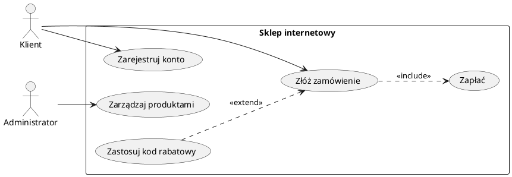

# Spotkanie 2. Wymagania i diagram przypadków użycia

| ⏱ Czas | 🎓 Efekt | 📝 Do oddania |
|---|---|---|
| ok. 85 min | Tabela wymagań, diagram UC, scenariusze | Rozdział 2: Specyfikacja wymagań |

## 🎯 Cele spotkania

Po zajęciach potrafisz:

- odróżnić wymagania funkcjonalne od niefunkcjonalnych i poprawnie je formułować,
- nadać wymaganiom identyfikatory, priorytety i kryteria akceptacji,
- wskazać aktorów i przypadki użycia systemu,
- narysować poprawny diagram przypadków użycia w UML i opisać scenariusze.

## 📖 1. Wprowadzenie teoretyczne (ok. 25 min)

### Inżynieria wymagań

**Wymaganie** to opis tego, co system ma robić lub jakie właściwości ma mieć, sformułowany tak, by dało się sprawdzić, czy zostało spełnione.

- **Wymagania funkcjonalne (FR)** opisują zachowanie systemu: „System umożliwia użytkownikowi zarejestrowanie konta”.
- **Wymagania niefunkcjonalne (NFR)** opisują jakość działania i ograniczenia: wydajność, bezpieczeństwo, użyteczność, niezawodność, przenośność, utrzymywalność (kategorie zgodne z normą ISO/IEC 25010).

**📌 Cechy dobrego wymagania:** jednoznaczne, weryfikowalne, atomowe (jedna myśl), spójne z pozostałymi, niezależne od sposobu implementacji, możliwe do zrealizowania.

| ❌ Zły zapis | ✅ Poprawny zapis |
|---|---|
| System ma działać szybko. | **NFR-01:** Wyświetlenie listy produktów trwa nie dłużej niż 2 s dla 95% żądań przy 100 jednoczesnych użytkownikach. |
| System ma być bezpieczny. | **NFR-02:** Hasła użytkowników są przechowywane wyłącznie w postaci skrótu z solą. |
| Użytkownik zarządza kontem. | **FR-03:** Użytkownik może zmienić hasło po podaniu aktualnego hasła. |

**Priorytetyzacja MoSCoW:** *Must have* (konieczne), *Should have* (ważne), *Could have* (pożądane), *Won't have* (tym razem nie).

**Format tabeli wymagań:**

| ID | Typ | Opis | Priorytet | Aktor / źródło | Kryterium akceptacji |
|---|:---:|---|:---:|---|---|
| FR-01 | FR | Użytkownik może zarejestrować konto | Must | Gość | Po podaniu poprawnych danych konto jest utworzone, a użytkownik otrzymuje e-mail potwierdzający |

### Diagram przypadków użycia (Use Case Diagram)

Diagram opisuje funkcjonalność systemu z punktu widzenia użytkowników. Jego elementy:

| Element | Znaczenie |
|---|---|
| **Aktor** | człowiek lub system zewnętrzny wchodzący w interakcję z systemem |
| **Przypadek użycia** | owal; cel aktora, nazwany czasownikiem („Złóż zamówienie”) |
| **Granica systemu** | prostokąt otaczający przypadki użycia |
| **Asocjacja** | linia łącząca aktora z przypadkiem |
| **`include`** | przypadek zawsze wywołuje inny |
| **`extend`** | przypadek opcjonalnie rozszerza inny |
| **Uogólnienie** | specjalizacja aktorów lub przypadków |

<b>Przykład w PlantUML</b>

**ℹ️ Uwaga:** GitHub ani GitHub Pages nie rysują PlantUML. Wygeneruj diagram do PNG/SVG (wtyczka w IDE lub plantuml.com) i dołącz obraz do dokumentu, trzymając w repozytorium także plik źródłowy `.puml`.

<b>Szablon opisu scenariusza przypadku użycia</b> (kliknij, aby rozwinąć)

| Pole | Treść |
|---|---|
| Nazwa | UC2: Złóż zamówienie |
| Aktor główny | Klient |
| Warunki wstępne | Klient jest zalogowany, koszyk zawiera co najmniej jeden produkt |
| Scenariusz główny | 1. Klient wybiera „Zamów”. 2. System wyświetla podsumowanie. 3. Klient potwierdza zamówienie. 4. System rejestruje zamówienie i przekazuje do płatności. |
| Scenariusze alternatywne | 3a. Klient rezygnuje: system zachowuje koszyk. |
| Warunki końcowe | Zamówienie istnieje w systemie ze statusem „oczekuje na płatność” |
| Powiązane wymagania | FR-05, FR-06 |

## 🛠 2. Zadania na zajęciach (ok. 60 min)

| # | Zadanie | Czas |
|---|---|:---:|
| **2.1** | **Lista wymagań.** Na podstawie RFP ze spotkania 1 sporządź tabelę: min. 10 FR i min. 5 NFR (co najmniej 3 różne kategorie jakości). Każde wymaganie ma ID, priorytet MoSCoW i kryterium akceptacji. | 20 min |
| **2.2** | **Aktorzy.** Zidentyfikuj min. 3 aktorów, w tym, jeśli ma to sens, jednego będącego systemem zewnętrznym. | 5 min |
| **2.3** | **Diagram przypadków użycia.** Min. 8 przypadków, co najmniej jedna relacja `include` i jedna `extend`. | 20 min |
| **2.4** | **Opis scenariuszy.** Opisz wg szablonu min. 3 najważniejsze przypadki, każdy z co najmniej jednym scenariuszem alternatywnym. | 15 min |
| **2.5** | **Macierz śledzenia** *(do domu)*. Tabela łącząca wymagania FR z przypadkami użycia. | – |

## 📝 3. Fragment pracy inżynierskiej do oddania

Przygotuj tekst **Rozdziału 2: Specyfikacja wymagań** (4–7 stron):

- **2.1** Metodyka pozyskiwania i spisywania wymagań (jak powstały, jaka notacja i priorytetyzacja)
- **2.2** Wymagania funkcjonalne (tabela)
- **2.3** Wymagania niefunkcjonalne (tabela, pogrupowana wg kategorii jakości)
- **2.4** Aktorzy i diagram przypadków użycia (rysunek z podpisem i omówieniem)
- **2.5** Opisy wybranych przypadków użycia
- **2.6** Macierz śledzenia wymagań

**📌 Ważne:** każdy rysunek i tabela musi mieć numer, podpis i odwołanie w tekście. Źródła (normy, literatura) zapisujesz zgodnie z wymogami edycyjnymi pracy dyplomowej.

## ✅ 4. Kryteria oceny

| Element | Co oceniamy |
|---|---|
| Tabela wymagań | jednoznaczność, weryfikowalność, kryteria akceptacji, różnorodność NFR |
| Diagram UC | poprawność notacji UML, granica systemu, sensowne nazwy, poprawne użycie include/extend |
| Opisy scenariuszy | kompletność, scenariusze alternatywne, powiązanie z wymaganiami |
| Macierz śledzenia | brak wymagań bez przypadków użycia i odwrotnie |
| Rozdział 2 | spójność z Rozdziałem 1 i RFP, język, opisy rysunków |

## ☑️ 5. Lista kontrolna

- [ ] Co najmniej 10 FR i 5 NFR, każde z ID, priorytetem i kryterium akceptacji
- [ ] Brak wymagań typu „system ma być szybki/przyjazny”
- [ ] Min. 3 aktorów i 8 przypadków użycia na diagramie
- [ ] Użyte `include` i `extend` (poprawny kierunek strzałek)
- [ ] 3 opisane scenariusze z alternatywami
- [ ] Macierz śledzenia FR–UC
- [ ] Pliki diagramów (źródło + eksport) w repozytorium

## ⚠️ 6. Częste błędy

- Mieszanie wymagań z rozwiązaniami technicznymi („system używa MySQL” jako wymaganie funkcjonalne).
- Przypadki użycia nazwane jak funkcje techniczne („Zapisz do bazy”) zamiast celów użytkownika.
- Przypadki użycia będące pojedynczymi krokami scenariusza (zbyt drobne).
- Odwrócony kierunek strzałki `extend` (powinna wskazywać na przypadek rozszerzany).
- Aktor jako technologia lub moduł systemu zamiast roli spoza systemu.

<b>❓ Pytania kontrolne (na kolokwium)</b>

1. Czym różni się wymaganie funkcjonalne od niefunkcjonalnego? Podaj po dwa przykłady.
2. Jakie cechy ma dobre wymaganie? Przeformułuj: „System ma być łatwy w obsłudze”.
3. Kiedy stosuje się relację `include`, a kiedy `extend`?
4. Czym jest aktor w UML? Czy aktorem może być system zewnętrzny?
5. Do czego służy macierz śledzenia wymagań?

## 📚 Literatura

- I. Sommerville, *Inżynieria oprogramowania*, PWN (rozdziały o wymaganiach i modelowaniu systemów).
- M. Fowler, *UML Distilled. Krótki przewodnik po standardowym języku modelowania obiektowego*.
- Specyfikacja OMG UML: [omg.org/spec/UML](https://www.omg.org/spec/UML)
- ISO/IEC 25010: model jakości produktu programowego.
- Dokumentacja PlantUML: [plantuml.com](https://plantuml.com)

---

**Wstecz:** [Spotkanie 1. Dokumentacja techniczna (RFI i RFP)](spotkanie-01.md) · [Strona główna](../README.md)
