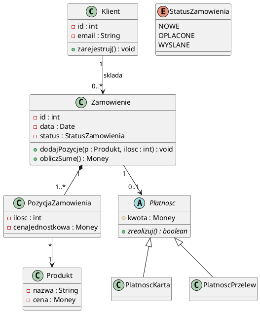
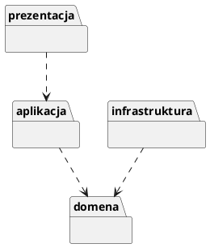

# Spotkanie 3. Struktura klas: diagram klas i diagram pakietów

| Czas | Zakres | Wynik pracy |
|---|---|---|
| ok. 85 min | Analiza struktury klas, diagram klas, diagram pakietów | Lista klas z uzasadnieniem, diagram klas, opis relacji, diagram pakietów |

## Cele spotkania

Po zajęciach student potrafi:

- wyodrębnić klasy, atrybuty i operacje na podstawie wymagań i scenariuszy przypadków użycia,
- zapisać strukturę systemu w postaci diagramu klas w UML, z poprawnymi relacjami i krotnościami,
- odróżnić asocjację, agregację, kompozycję, zależność, uogólnienie i realizację interfejsu,
- zgrupować klasy w pakiety i zapisać zależności między nimi na diagramie pakietów,
- ocenić, czy model jest spójny ze specyfikacją wymagań.

## 1. Wprowadzenie teoretyczne (ok. 25 min)

### Analiza struktury klas

Celem analizy jest zidentyfikowanie pojęć występujących w systemie i powiązań między nimi. Wyróżnia się dwa poziomy szczegółowości:

- **model dziedziny (konceptualny):** klasy odpowiadają pojęciom ze świata problemu (Zamówienie, Produkt), zwykle bez operacji i bez szczegółów technicznych,
- **model projektowy:** klasy uzupełnione o typy atrybutów, operacje, widoczność i interfejsy, przygotowane do implementacji.

**Technika analizy tekstu.** Scenariusze przypadków użycia i wymagania ze spotkania 2 są analizowane pod kątem słownictwa:

- rzeczowniki są kandydatami na klasy lub atrybuty,
- czasowniki są kandydatami na operacje lub relacje,
- odrzuca się synonimy, pojęcia spoza zakresu systemu, rzeczowniki będące wyłącznie atrybutami (np. „data”, „cena”) oraz byty zbyt ogólne („system”, „informacja”).

Aktor i klasa to różne pojęcia. Aktor jest rolą zewnętrzną wobec systemu, a klasa (np. Klient) reprezentuje dane i zachowania przechowywane w systemie. Nie każdy aktor ma odpowiadającą mu klasę.

### Notacja diagramu klas

| Element | Zapis |
|---|---|
| Klasa | prostokąt z trzema przedziałami: nazwa, atrybuty, operacje |
| Widoczność | `+` publiczna, `-` prywatna, `#` chroniona, `~` pakietowa |
| Atrybut | `- cena : Money` |
| Operacja | `+ dodajPozycje(p : Produkt, ilosc : int) : void` |
| Klasa abstrakcyjna | nazwa kursywą lub `{abstract}` |
| Interfejs | stereotyp `<<interface>>` |
| Typ wyliczeniowy | stereotyp `<<enumeration>>` |

### Relacje między klasami

| Relacja | Znaczenie | Przykład |
|---|---|---|
| **Asocjacja** | obiekty są ze sobą powiązane (linia, nazwa, krotności) | Klient składa Zamówienia |
| **Agregacja** | „ma”; część może istnieć samodzielnie (pusty romb) | Katalog zawiera Produkty |
| **Kompozycja** | „składa się z”; część nie istnieje bez całości (pełny romb) | Zamówienie składa się z Pozycji |
| **Zależność** | jedna klasa używa drugiej, bez trwałego powiązania (linia przerywana) | Serwis korzysta z Walidatora |
| **Uogólnienie** | „jest rodzajem” (dziedziczenie, trójkąt) | Płatność kartą jest Płatnością |
| **Realizacja** | klasa implementuje interfejs (linia przerywana z trójkątem) | Klasa realizuje interfejs Powiadomienie |

**Krotności:** `1`, `0..1`, `*` (dowolna liczba), `1..*`. Brak krotności jest jednym z najczęstszych błędów.

<b>Przykład w PlantUML</b>

### Diagram pakietów

**Pakiet** jest mechanizmem grupowania elementów modelu (klas, komponentów, innych pakietów). Diagram pakietów pokazuje strukturę grup oraz zależności między nimi. Podstawowe zasady podziału:

- wysoka spójność wewnątrz pakietu (elementy realizują wspólną odpowiedzialność),
- niskie sprzężenie między pakietami (mało zależności, jednokierunkowych),
- brak zależności cyklicznych,
- typowy podział warstwowy: prezentacja, logika aplikacji, domena, dostęp do danych.

<b>Przykład diagramu pakietów w PlantUML</b> (sekcja zwijana)

**Uwaga:** GitHub ani GitHub Pages nie rysują PlantUML. Diagramy należy eksportować do PNG/SVG i dołączać jako obrazy, przechowując w repozytorium także pliki źródłowe `.puml`.

## 2. Zadania na zajęciach (ok. 60 min)

| # | Zadanie | Czas |
|---|---|:---:|
| **3.1** | **Analiza tekstu.** Na podstawie scenariuszy przypadków użycia i wymagań ze spotkania 2 sporządzana jest lista kandydatów na klasy, z zaznaczeniem pojęć odrzuconych i krótkim uzasadnieniem odrzucenia. | 15 min |
| **3.2** | **Diagram klas.** Model zawierający 6–8 klas z atrybutami (typy), operacjami i widocznością. Wymagane: krotności przy wszystkich asocjacjach, co najmniej jedno uogólnienie lub interfejs oraz co najmniej jedna kompozycja lub agregacja. | 25 min |
| **3.3** | **Opis relacji.** Tabela: relacja, krotność, uzasadnienie wyboru (np. dlaczego kompozycja, a nie agregacja). | 10 min |
| **3.4** | **Diagram pakietów.** Podział klas na 3–5 pakietów i zaznaczenie zależności, bez cykli. | 10 min |
| **3.5** | **Pokrycie funkcjonalności** *(praca własna)*. Tabela wskazująca, które klasy realizują które przypadki użycia. Funkcjonalność bez klas lub klasa bez związku z funkcjonalnością wymaga poprawy modelu. | – |

## 3. Wykorzystanie w pracy inżynierskiej

Diagram klas jest jednym z najczęściej wykorzystywanych artefaktów w pracach z częścią projektową, ale w pracy dyplomowej wystarcza jego uproszczona postać.

| Artefakt z zajęć | Możliwe wykorzystanie w pracy | Kiedy pominąć lub skrócić |
|---|---|---|
| Diagram klas | Wersja uproszczona w treści (klasy kluczowe, bez metod dostępowych); pełny diagram w załączniku | W pracy niezorientowanej obiektowo (np. analiza danych, uczenie maszynowe) zastępowany diagramem danych lub przepływu przetwarzania |
| Opis relacji | Wybrane decyzje projektowe wymagające uzasadnienia, jako akapit | Gdy model jest oczywisty |
| Diagram pakietów | W treści, jeżeli system ma wyraźną architekturę warstwową | Przy małym systemie: pominąć albo połączyć z opisem architektury (spotkanie 4) |
| Lista pojęć dziedziny | Słowniczek lub opis dziedziny w części wstępnej | Gdy dziedzina jest powszechnie znana |

## 4. Przedmiot oceny

| Element | Co jest oceniane |
|---|---|
| Lista klas | uzasadnione odrzucenia, brak klas pozornych („System”, „Dane”) |
| Diagram klas | poprawność notacji UML, krotności, trafny dobór relacji, rozsądny poziom szczegółowości |
| Opis relacji | poprawne rozróżnienie kompozycji i agregacji, uzasadnienie |
| Diagram pakietów | spójność pakietów, brak cykli, kierunek zależności |
| Spójność | zgodność z wymaganiami i przypadkami użycia ze spotkania 2 |

## 5. Kryteria kompletności wyniku

- Każda klasa ma nazwę w liczbie pojedynczej, atrybuty z typami i operacje wynikające ze scenariuszy.
- Wszystkie asocjacje mają krotności.
- Użyta co najmniej jedna relacja uogólnienia lub realizacji interfejsu oraz co najmniej jedna kompozycja lub agregacja, z uzasadnieniem.
- Każda funkcjonalność z wykazu jest realizowana przez co najmniej jedną klasę.
- Pakiety mają uzasadniony podział, a zależności między nimi nie tworzą cykli.
- Pliki źródłowe i eksport diagramów znajdują się w repozytorium.

## 6. Częste błędy

- Klasy nazwane czynnościami („Składanie zamówienia”) zamiast pojęciami dziedziny.
- Brak krotności lub krotności przypadkowe.
- Mylenie kompozycji z agregacją (kryterium: czy część istnieje bez całości).
- Dziedziczenie użyte tylko do współdzielenia kodu, a nie dla relacji „jest rodzajem”.
- Klasa-„bóg”, która zawiera większość operacji systemu.
- Szczegółowe listowanie metod dostępowych (get/set), które zaciemnia diagram.
- Cykliczne zależności między pakietami.

<b>Pytania kontrolne (kolokwium)</b> (sekcja zwijana)

1. Jak na podstawie scenariuszy przypadków użycia wyodrębnia się kandydatów na klasy i operacje?
2. Czym różni się aktor od klasy? Podać przykład aktora, który nie ma odpowiadającej mu klasy.
3. Czym różni się agregacja od kompozycji? Podać po jednym przykładzie.
4. Co oznaczają krotności `0..1`, `1..*` i `*`?
5. Kiedy stosuje się uogólnienie, a kiedy realizację interfejsu?
6. Jakie są zasady poprawnego podziału na pakiety? Dlaczego cykle zależności są niepożądane?
7. Czym różni się model dziedziny od modelu projektowego?

## Literatura

- M. Fowler, *UML Distilled. Krótki przewodnik po standardowym języku modelowania obiektowego*.
- I. Sommerville, *Inżynieria oprogramowania*, PWN (modelowanie systemów).
- Specyfikacja OMG UML: [omg.org/spec/UML](https://www.omg.org/spec/UML)
- Dokumentacja PlantUML (diagram klas, diagram pakietów): [plantuml.com](https://plantuml.com)

---

**Wstecz:** [Spotkanie 2](spotkanie-02.md) · **Dalej:** [Spotkanie 4. Diagram komponentów i diagram sekwencji](spotkanie-04.md) · [Strona główna](../)
