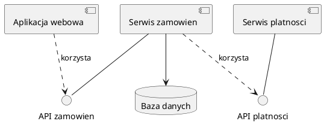
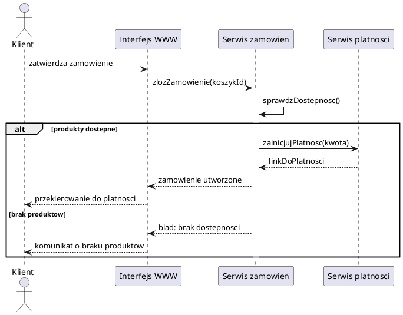

# Spotkanie 4. Diagram komponentów i diagram sekwencji

| Czas | Zakres | Wynik pracy |
|---|---|---|
| ok. 85 min | Architektura (komponenty), analiza funkcjonalności, diagram sekwencji | Diagram komponentów, diagramy sekwencji kluczowych scenariuszy |

## Cele spotkania

Po zajęciach student potrafi:

- wyodrębnić komponenty systemu i zapisać ich interfejsy na diagramie komponentów,
- odróżnić komponent od klasy i od pakietu,
- przeanalizować wybraną funkcjonalność jako przebieg komunikatów między uczestnikami,
- sporządzić diagram sekwencji z fragmentami złożonymi (alt, opt, loop),
- zweryfikować spójność diagramu sekwencji z diagramem klas i diagramem komponentów.

## 1. Wprowadzenie teoretyczne (ok. 25 min)

### Diagram komponentów

**Komponent** to modularna, wymienialna część systemu, która ukrywa swoją implementację za jawnie zdefiniowanymi interfejsami. Przykłady: aplikacja kliencka, serwis REST, moduł biblioteczny, baza danych.

| Pojęcie | Poziom | Znaczenie |
|---|---|---|
| Klasa | kod | podstawowy element programu obiektowego |
| Pakiet | organizacja modelu | logiczne grupowanie elementów, bez semantyki wdrożeniowej |
| Komponent | architektura | grupa współpracujących klas z jasnym interfejsem, możliwa do wymiany lub wdrożenia osobno |

Elementy diagramu komponentów:

- **interfejs dostarczany** (provided): usługa, którą komponent udostępnia (symbol „lizaka”),
- **interfejs wymagany** (required): usługa, której komponent potrzebuje (symbol „gniazda”),
- **port**: punkt, przez który komponent komunikuje się z otoczeniem,
- **zależność**: komponent korzysta z interfejsu innego komponentu.

Dobór komponentów wynika z odpowiedzialności (np. interfejs użytkownika, logika zamówień, płatności, składowanie danych) oraz z wymagań niefunkcjonalnych (np. wymiana dostawcy płatności, skalowalność).

<b>Przykład diagramu komponentów w PlantUML</b>

### Analiza funkcjonalności i diagram sekwencji

**Diagram sekwencji** pokazuje, w jakiej kolejności uczestnicy (aktorzy, komponenty, obiekty) wymieniają komunikaty w ramach jednego scenariusza. Jest naturalnym uszczegółowieniem scenariusza przypadku użycia ze spotkania 2.

| Element | Znaczenie |
|---|---|
| Linia życia | pionowa linia reprezentująca uczestnika w czasie |
| Aktywacja | wąski prostokąt, gdy uczestnik wykonuje operację |
| Komunikat synchroniczny | ciągła strzałka; nadawca czeka na zakończenie |
| Komunikat asynchroniczny | strzałka z otwartym grotem; nadawca nie czeka |
| Odpowiedź | strzałka przerywana |
| Komunikat do samego siebie | strzałka zawracająca |
| Fragment `alt` | alternatywa (jak if/else) |
| Fragment `opt` | krok opcjonalny |
| Fragment `loop` | powtarzanie |

**Procedura analizy funkcjonalności:**

1. Wybór funkcjonalności i odpowiadającego jej przypadku użycia.
2. Ustalenie uczestników: aktor inicjujący oraz komponenty i klasy biorące udział w realizacji.
3. Przełożenie kroków scenariusza głównego na kolejne komunikaty.
4. Scenariusze alternatywne i obsługa błędów jako fragmenty `alt` lub `opt`.
5. Weryfikacja: nazwy komunikatów odpowiadają operacjom z diagramu klas, a uczestnicy komponentom z diagramu komponentów.

Sekwencje rysuje się dla scenariuszy kluczowych, złożonych lub ryzykownych. Rysowanie diagramu dla każdego przypadku użycia nie jest celowe.

<b>Przykład diagramu sekwencji w PlantUML</b>

**Uwaga:** GitHub ani GitHub Pages nie rysują PlantUML. Diagramy należy eksportować do PNG/SVG i dołączać jako obrazy, przechowując w repozytorium także pliki źródłowe `.puml`.

## 2. Zadania na zajęciach (ok. 60 min)

| # | Zadanie | Czas |
|---|---|:---:|
| **4.1** | **Wyodrębnienie komponentów.** Wskazanie 3–6 komponentów systemu wraz z odpowiedzialnością każdego i interfejsami (dostarczanymi i wymaganymi). Uzasadnienie podziału (jedno–dwa zdania na komponent). | 15 min |
| **4.2** | **Diagram komponentów.** Zapis wyników zadania 4.1 w UML, z zaznaczeniem komponentów zewnętrznych (np. system płatności, baza danych). | 10 min |
| **4.3** | **Wybór scenariuszy.** Wybór 2–3 kluczowych funkcjonalności do analizy z uzasadnieniem (złożoność, ryzyko, znaczenie dla użytkownika). | 5 min |
| **4.4** | **Diagramy sekwencji.** Min. 2 diagramy: jeden dla scenariusza głównego, drugi z fragmentem `alt`, `opt` lub `loop`. Uczestnicy: aktor oraz komponenty lub klasy. | 25 min |
| **4.5** | **Weryfikacja spójności.** Zestawienie: każdy komunikat na diagramie sekwencji ma odpowiadającą operację w diagramie klas lub interfejs w diagramie komponentów. Braki skutkują uzupełnieniem modelu. | 5 min |

## 3. Wykorzystanie w pracy inżynierskiej

| Artefakt z zajęć | Możliwe wykorzystanie w pracy | Kiedy pominąć lub skrócić |
|---|---|---|
| Diagram komponentów | Podstawa opisu architektury systemu: jeden diagram w treści pracy z krótkim omówieniem komponentów i interfejsów | System jednomodułowy lub skrypt: wystarczy opis słowny albo prosty schemat |
| Uzasadnienie podziału na komponenty | Akapit o decyzjach architektonicznych, zwłaszcza gdy wynikają z wymagań niefunkcjonalnych | Gdy decyzje są oczywiste |
| Diagramy sekwencji | 1–3 diagramy najważniejszych lub najbardziej złożonych scenariuszy; pozostałe w załączniku | Gdy przebieg jest trywialny |
| Zestawienie spójności | Zwykle tylko w dokumentacji roboczej | Zwykle pomijane w treści pracy |

## 4. Przedmiot oceny

| Element | Co jest oceniane |
|---|---|
| Diagram komponentów | sensowny podział odpowiedzialności, poprawne interfejsy dostarczane i wymagane |
| Uzasadnienie podziału | związek z wymaganiami i z modelem klas |
| Diagramy sekwencji | poprawność notacji, właściwe użycie fragmentów złożonych, czytelność |
| Spójność | zgodność komunikatów z operacjami klas i z interfejsami komponentów |

## 5. Kryteria kompletności wyniku

- Każdy komponent ma jasno określoną odpowiedzialność i co najmniej jeden interfejs.
- Zależności na diagramie komponentów są jednokierunkowe i nie tworzą oczywistych cykli.
- Dwa diagramy sekwencji dotyczą funkcjonalności z wykazu ze spotkania 1.
- Co najmniej jeden diagram zawiera fragment `alt`, `opt` lub `loop`.
- Nazwy komunikatów są zgodne z operacjami z diagramu klas lub interfejsami komponentów.
- Pliki źródłowe i eksport diagramów znajdują się w repozytorium.

## 6. Częste błędy

- Mylenie komponentu z pakietem lub klasą (komponent bez interfejsu jest tylko pudełkiem).
- Zbyt wiele komponentów w małym systemie lub jeden komponent „wszystko”.
- Diagram sekwencji przypominający algorytm w kodzie (zbyt drobne kroki).
- Komunikaty nienależące do żadnej operacji w modelu klas.
- Pominięcie ścieżek alternatywnych i obsługi błędów.
- Strzałki zwrotne wstawiane przy każdym komunikacie, co utrudnia czytanie.

<b>Pytania kontrolne (kolokwium)</b> (sekcja zwijana)

1. Czym różni się komponent od klasy i od pakietu?
2. Co oznaczają interfejs dostarczany i interfejs wymagany? Podać przykład.
3. Jak z scenariusza przypadku użycia otrzymuje się diagram sekwencji?
4. Do czego służą fragmenty `alt`, `opt` i `loop`?
5. Czym różni się komunikat synchroniczny od asynchronicznego?
6. Jak sprawdzić, że diagram sekwencji jest spójny z diagramem klas?
7. Dla jakich scenariuszy warto rysować diagram sekwencji, a dla jakich jest to zbędne?

## Literatura

- M. Fowler, *UML Distilled. Krótki przewodnik po standardowym języku modelowania obiektowego*.
- I. Sommerville, *Inżynieria oprogramowania*, PWN (architektura i modelowanie interakcji).
- Specyfikacja OMG UML: [omg.org/spec/UML](https://www.omg.org/spec/UML)
- Dokumentacja PlantUML (diagram komponentów, diagram sekwencji): [plantuml.com](https://plantuml.com)

---

**Wstecz:** [Spotkanie 3](spotkanie-03.md) · **Dalej:** [Spotkanie 5. Procesy biznesowe i projektowanie testów automatycznych](spotkanie-05.md) · [Strona główna](../)
