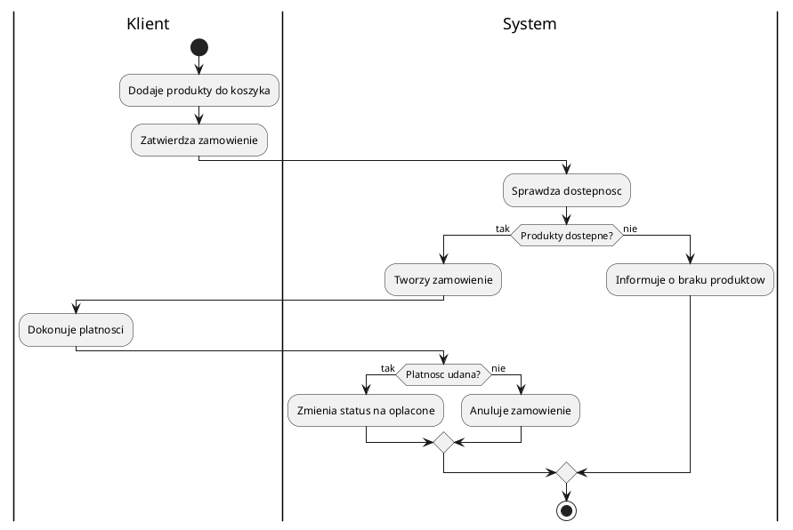

# Spotkanie 5. Procesy biznesowe i projektowanie testów automatycznych

| Czas | Zakres | Wynik pracy |
|---|---|---|
| ok. 90 min | Diagram aktywności, projektowanie testów automatycznych | Diagram aktywności, zestaw przypadków testowych, szkielety testów automatycznych |

## Cele spotkania

Po zajęciach student potrafi:

- opisać proces biznesowy systemu w postaci diagramu aktywności z decyzjami, równoległością i torami,
- wyznaczyć ścieżki przebiegu procesu i wykorzystać je jako podstawę przypadków testowych,
- wskazać poziomy testowania oraz dobrać do nich techniki projektowania testów,
- zapisać przypadek testowy w ustandaryzowanej formie i powiązać go z wymaganiem,
- przygotować szkielet testu automatycznego w wybranym frameworku.

## 1. Wprowadzenie teoretyczne (ok. 30 min)

### Procesy biznesowe i diagram aktywności

**Proces biznesowy** to uporządkowany ciąg działań prowadzący do określonego rezultatu, często angażujący wielu uczestników (np. od złożenia zamówienia do jego dostarczenia). Różni się od pojedynczej funkcjonalności tym, że obejmuje cały przebieg, a nie jedną interakcję. **Diagram aktywności** opisuje taki przebieg jako graf działań i decyzji.

| Element | Znaczenie |
|---|---|
| Węzeł początkowy i końcowy | start i zakończenie procesu |
| Akcja | pojedyncze działanie |
| Decyzja i scalenie | rozgałęzienie warunkowe i ponowne połączenie ścieżek |
| Rozwidlenie i złączenie (fork/join) | działania równoległe i ich synchronizacja |
| Tor (swimlane) | przypisanie działań do uczestnika lub komponentu |
| Przepływ obiektów | przekazywanie danych między działaniami |

Diagram aktywności, diagram sekwencji i przypadki użycia opisują to samo z różnych perspektyw: aktywności pokazują przebieg i decyzje, sekwencja kolejność komunikatów, a przypadek użycia cel aktora. Dla procesów biznesowych alternatywą jest notacja BPMN, która nie jest częścią UML.

<details markdown="1" open>
<summary><b>Przykład diagramu aktywności w PlantUML</b></summary>



</details>

### Projektowanie testów automatycznych

**Test** sprawdza, czy system spełnia wymaganie. Projektowanie testów polega na wyborze przypadków testowych, które z rozsądnym nakładem wykryją najwięcej błędów, oraz na zapisaniu ich w postaci możliwej do automatycznego uruchamiania.

**Poziomy testowania (piramida testów):**

| Poziom | Przedmiot | Charakterystyka |
|---|---|---|
| Jednostkowy | pojedyncza klasa lub funkcja | szybki, liczny, izolowany |
| Integracyjny | współpraca komponentów, baza danych, API | wolniejszy, mniej licznych |
| Systemowy / akceptacyjny (E2E) | cały system z perspektywy użytkownika | najwolniejszy, najmniej licznych, najbliższy wymaganiom |

**Źródła przypadków testowych:** kryteria akceptacji wymagań (spotkanie 2), scenariusze przypadków użycia, ścieżki diagramu aktywności (każda ścieżka podstawowa i alternatywna to kandydat na test), diagramy sekwencji (komunikaty i błędy).

**Techniki projektowania:**

- **klasy równoważności:** dane wejściowe dzieli się na klasy, w których system zachowuje się tak samo, i testuje po jednym reprezentancie,
- **wartości brzegowe:** testowanie na granicach zakresów (np. wartość minimalna, maksymalna i tuż poza zakresem),
- **tabela decyzyjna:** zestawienie kombinacji warunków i oczekiwanych wyników.

**Przypadek testowy** zawiera: identyfikator, powiązane wymaganie, warunki wstępne, dane wejściowe, kroki, wynik oczekiwany, poziom testu.

| ID | Wymaganie | Warunki wstępne | Dane / kroki | Wynik oczekiwany | Poziom |
|---|---|---|---|---|---|
| TC-03 | FR-03 | Użytkownik zalogowany | Zmiana hasła, podanie błędnego aktualnego hasła | Hasło niezmienione, komunikat o błędzie | Akceptacyjny |

**Zasady dobrego testu automatycznego:** niezależność od innych testów, powtarzalność, jedna weryfikowana rzecz, czytelna nazwa opisująca zachowanie, struktura *Arrange–Act–Assert* (przygotowanie, wykonanie, sprawdzenie).

<details markdown="1">
<summary><b>Przykład szkieletu testu jednostkowego (Python, pytest)</b> (sekcja zwijana)</summary>

```python
import pytest

def test_obliczSume_zamowienia_dla_dwoch_pozycji():
    # Arrange
    zamowienie = Zamowienie()
    zamowienie.dodaj_pozycje(Produkt("Kubek", 20.00), ilosc=2)
    zamowienie.dodaj_pozycje(Produkt("Talerz", 35.50), ilosc=1)
    # Act
    suma = zamowienie.oblicz_sume()
    # Assert
    assert suma == pytest.approx(75.50)
```

Wybór języka i frameworku (np. pytest, JUnit, Jest) zależy od technologii własnego systemu. Pokrycie kodu testami jest metryką pomocniczą i nie zastępuje przemyślanego doboru przypadków.

</details>

## 2. Zadania na zajęciach (ok. 60 min)

| # | Zadanie | Czas |
|---|---|:---:|
| **5.1** | **Wybór procesu.** Wskazanie 1–2 procesów biznesowych systemu (np. realizacja zamówienia) i ich krótki opis tekstowy. | 5 min |
| **5.2** | **Diagram aktywności.** Diagram z min. 2 decyzjami i torami dla co najmniej dwóch uczestników. Jeśli proces na to pozwala, element równoległy (fork/join). | 15 min |
| **5.3** | **Ścieżki procesu.** Wyznaczenie i ponumerowanie ścieżki podstawowej oraz ścieżek alternatywnych (błędy, odrzucenia). | 5 min |
| **5.4** | **Przypadki testowe.** Min. 8 przypadków zapisanych w tabeli (jak wyżej), wynikających z ścieżek procesu i scenariuszy przypadków użycia. Dla co najmniej jednego pola danych zastosowane klasy równoważności i wartości brzegowe. Każdy przypadek powiązany z wymaganiem. | 20 min |
| **5.5** | **Szkielety testów automatycznych.** Zapis dwóch przypadków w kodzie: jednego jednostkowego i jednego integracyjnego lub akceptacyjnego (ciało testu może korzystać z atrap, jeśli system nie jest jeszcze zaimplementowany). | 15 min |
| **5.6** | **Macierz testów i wymagań** *(praca własna)*. Zestawienie wskazujące, które wymagania są pokryte testami. | – |

## 3. Wykorzystanie w pracy inżynierskiej

| Artefakt z zajęć | Możliwe wykorzystanie w pracy | Kiedy pominąć lub skrócić |
|---|---|---|
| Diagram aktywności | W treści, jeżeli praca dotyczy procesu lub systemu wspierającego proces biznesowy | System bez istotnego procesu: pominąć |
| Plan testów | Krótki opis strategii testowania (poziomy, narzędzia, kryteria) w treści pracy | Praca niezwiązana z jakością oprogramowania: wystarczy akapit |
| Tabela przypadków testowych | Wybrane, reprezentatywne przypadki w treści; pełna tabela w załączniku | Gdy testowanie nie jest istotne dla tematu |
| Szkielety testów, wyniki uruchomienia | Fragmenty kodu i wynik w opisie weryfikacji systemu; całość w repozytorium | Przy braku implementacji |
| Macierz testów i wymagań | Załącznik lub dokumentacja robocza | Zwykle pomijana w treści |

## 4. Przedmiot oceny

| Element | Co jest oceniane |
|---|---|
| Diagram aktywności | poprawność notacji, decyzje i tory, kompletność ścieżek |
| Przypadki testowe | wynikanie z modelu i wymagań, pokrycie ścieżek, kompletność opisu |
| Techniki projektowania | poprawne zastosowanie klas równoważności i wartości brzegowych |
| Szkielety testów | czytelność, niezależność, struktura Arrange–Act–Assert |
| Spójność | powiązanie testów z wymaganiami i modelem |

## 5. Kryteria kompletności wyniku

- Diagram aktywności ma węzeł początkowy i końcowy, co najmniej dwie decyzje i tory.
- Wyznaczono ścieżkę podstawową oraz co najmniej dwie ścieżki alternatywne.
- Co najmniej 8 przypadków testowych z kompletem pól, każdy powiązany z wymaganiem.
- Zastosowano klasy równoważności i wartości brzegowe dla przynajmniej jednego pola.
- Dwa testy mają postać kodu i spełniają zasady niezależności oraz Arrange–Act–Assert.
- Pliki źródłowe diagramów, tabela testów i kod testów znajdują się w repozytorium.

## 6. Częste błędy

- Diagram aktywności będący schematem blokowym algorytmu (zbyt drobne działania).
- Tory bez uczestników lub działania przypisane do niewłaściwego toru.
- Przypadki testowe sprawdzające wyłącznie scenariusz pozytywny.
- Testy zależne od kolejności wykonania lub od stanu poprzednich testów.
- Wiele asercji niezwiązanych ze sobą w jednym teście.
- Dobór danych testowych bez uzasadnienia (brak klas równoważności).
- Niejasny wynik oczekiwany („działa poprawnie”).

<details markdown="1">
<summary><b>Pytania kontrolne (kolokwium)</b> (sekcja zwijana)</summary>

1. Czym różni się proces biznesowy od pojedynczej funkcjonalności?
2. Co oznaczają decyzja, rozwidlenie i tor na diagramie aktywności?
3. W jaki sposób ścieżki diagramu aktywności wykorzystuje się do projektowania testów?
4. Czym różnią się testy jednostkowe, integracyjne i akceptacyjne? Która liczba testów powinna być największa i dlaczego?
5. Na czym polegają klasy równoważności i wartości brzegowe? Podać przykład dla pola „wiek” z zakresem 18–65.
6. Jakie pola zawiera przypadek testowy?
7. Co oznacza struktura Arrange–Act–Assert?

</details>

## Literatura

- I. Sommerville, *Inżynieria oprogramowania*, PWN (testowanie oprogramowania).
- M. Fowler, *UML Distilled. Krótki przewodnik po standardowym języku modelowania obiektowego*.
- ISTQB, *Sylabus poziomu podstawowego* (techniki projektowania testów): [istqb.org](https://www.istqb.org)
- Dokumentacja wybranego frameworku testowego (pytest, JUnit, Jest).

---

**Wstecz:** [Spotkanie 4](spotkanie-04.md) · **Dalej:** [Spotkanie 6. Dokumentacja techniczna i automatyzacja](spotkanie-06.md) · [Strona główna](../)
